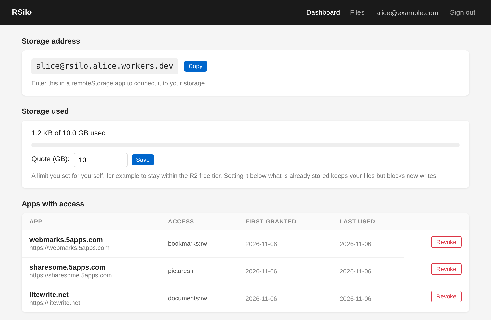
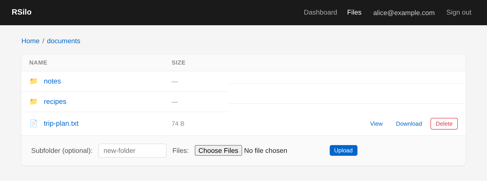

# RSilo

> **Canonical repository:** [jonocodes/RSilo on GitHub](https://github.com/jonocodes/RSilo). The Codeberg mirror is deprecated.

A [RemoteStorage.io](https://remotestorage.io)-compatible personal storage server that runs on Cloudflare Workers, with a built-in web file manager and OAuth server.

**Why this exists:** to give anyone — especially people who aren't technical — their own free, self-hosted place to back up and sync app data. One person, a small amount of data, no monthly bill, no vendor lock-in. Each deployment (an *Instance*) serves exactly one *Account*; more accounts means more Instances ([ADR-0002](docs/adr/0002-instances-are-single-user.md)).



## What is RemoteStorage?

RemoteStorage is an open protocol for syncing app data across devices. A server advertises where data lives, apps ask for permission to a module (like `documents` or `pictures`), then read/write files over plain HTTP.

- **WebFinger** advertises your storage and auth endpoints
- **OAuth 2.0** scopes grant apps access to specific modules
- **HTTP REST** reads and writes files under `/storage/:username/:module/:path`

## What you get

- **Your account area** at `/account` — a dashboard with your storage address, quota usage and setting, and the apps you have granted access (revocable), plus a file manager to browse, upload, download, view, edit, and delete files
- **API reference** at `/api` — a generated page listing every endpoint the server exposes
- **OAuth + WebFinger** so RemoteStorage apps can connect
- **Public sharing** through the `public` module
- Everything fits inside Cloudflare's **free tier** (see [Running on the Cloudflare free tier](docs/self-hosting.md#running-on-the-cloudflare-free-tier))



## Where to start

| If you want to… | Go to |
|-----------------|-------|
| Run your own server and connect your apps | [Self-hosting guide](docs/self-hosting.md) |
| Work on the code or run it locally | [Development guide](docs/development.md) |
| Read the endpoints, OAuth flow and storage scopes | [API reference](docs/api.md) |
| Understand the design decisions | [Domain glossary](CONTEXT.md) and [ADRs](docs/adr/) |
| See what changed, or report a security issue | [Changelog](CHANGELOG.md) · [Security policy](SECURITY.md) |

### Deploy your own

[](https://deploy.workers.cloudflare.com/?url=https://github.com/jonocodes/RSilo)

Click the button and enter your email, or run `bun install && wrangler login && bun run setup` from a checkout. Cloudflare Access must then protect `/account` so only you can open it: `bun run setup` does that itself when you paste a Cloudflare API token it links you to; otherwise [set it up in the dashboard](docs/self-hosting.md#set-up-cloudflare-access). The [self-hosting guide](docs/self-hosting.md) covers both paths, S3 storage, updates, backups and staying on the free tier.

### Run it locally

No Cloudflare account needed:

```bash
bun install
bun run db:setup:local
bun run dev:offline      # http://localhost:8787, signed in as alice@example.com
bun run test
```

See the [development guide](docs/development.md) for the Docker image, `wrangler dev`, the project layout and the test suites.

## Known limitations

- **Rate limiting is per Cloudflare location.** The native rate-limit bindings count per data centre, not globally, so a distributed attacker gets more attempts. Three limiters, each per IP per 60s: failed storage authentication (20), public-document reads without a valid token for the Account (300, enough for a page that loads many shared files at once), and every request to the token endpoint (20; an app redeems a code once and refreshes at most hourly). Syncs and public reads with the Account's own token are never throttled. Over the limit is `429` with `Retry-After`. Production fails closed with `503` when a limiter binding is missing; local-development mode skips limiting. KV is deliberately not used: its free tier allows only 1,000 writes a day, which per-request counters exhaust in minutes (#7).
- **Buffered uploads.** Upload bodies are bounded by `MAX_OBJECT_SIZE_BYTES` but buffered before storage so quota deltas can be reserved accurately. Downloads stream, except from the offline server.
- **Conditional writes are not atomic on S3.** On R2, `If-Match` / `If-None-Match: *` on `PUT` are checked by R2 in the same operation as the write. Backblaze B2 refuses those headers on uploads, so on S3 storage RSilo checks them against the `HEAD` it makes just before writing, and two apps writing the same file at the same moment can both succeed. Deletes are checked the same way on both backends, because R2 has no conditional delete.
- **Edits made directly to the bucket can take up to an hour to show in folder ETags.** RSilo caches each folder's ETag in D1 and clears it on every write it makes. A change made around RSilo, such as restoring files with `rclone copy`, is seen once the cached ETag expires, after an hour; until then apps see those folders as unchanged.
- **S3 folder listings have no content types.** S3 listings do not carry them, so on S3 storage a folder listing reports `application/octet-stream` for every document. A `GET` of the document returns its real type.
- **The account area shares the storage origin.** The remoteStorage spec (§14) suggests a separate origin for consent and revocation ([ADR-0004](docs/adr/0004-merged-account-control-plane.md)). RSilo serves stored files with `Content-Security-Policy: sandbox`, so they cannot run scripts on that origin.

## References

- [RemoteStorage Protocol Spec](https://remotestorage.io/protocol.html)
- [RemoteStorage.js (client library)](https://remotestorage.io/integrate/)
- [Armadietto (Node.js reference impl)](https://github.com/remotestorage/armadietto)
- [Cloudflare Workers](https://workers.cloudflare.com/)
- [Cloudflare R2](https://developers.cloudflare.com/r2/)
- [Cloudflare R2 pricing](https://developers.cloudflare.com/r2/pricing/)
- [Cloudflare budget alerts](https://developers.cloudflare.com/billing/manage/budget-alerts/)
- [Cloudflare D1](https://developers.cloudflare.com/d1/)
